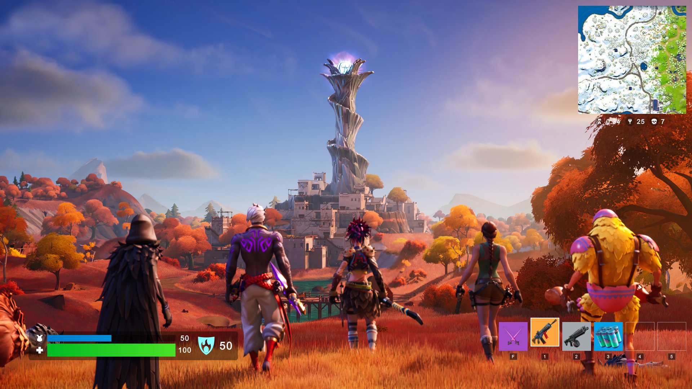

# Fortnite UI Sample for OneJS

A Fortnite style HUD built with [OneJS](https://onejs.com) 3: React 19 rendering through Unity's UI Toolkit. It needs no C#, no Inspector setup and no stylesheet, and its art and font come with it.



## Add it to your project

You need a Unity project (6.3 or newer) with OneJS 3.9.2 or newer and a JSRunner set up by **Initialize Project**. See [Quick Start](https://onejs.com/docs/quickstart) if you don't have that yet.

1. In the JSRunner's working directory (the `~` folder beside its PanelSettings), install the package:

   ```bash
   npm install fortnite-sample
   ```

2. Replace `index.tsx` with:

   ```tsx
   import { render } from "onejs-react"
   import { FortniteSample } from "fortnite-sample"

   render(<FortniteSample />, __root)
   ```

3. Save. The edit-mode preview shows the HUD in the Game view, and it runs the same way in Play mode.

A built-in demo drives it: health changes, the selected slot cycles, the storm timer counts down and the map pans.

## Feed it your game's numbers

Pass `stats` and the demo stops. Anything you leave out keeps its default.

```tsx
<FortniteSample stats={{ health: 72, shield: 30, slot: 2, storm: 95, players: 12, eliminations: 3 }} />
```

| Prop | What it does |
|------|--------------|
| `stats` | `health` and `shield` (0 to 100), `armor`, `slot` (0 to 5), `storm` (seconds), `players`, `eliminations` |
| `items` | The six action bar slots: `{ image, rarity }` or `null` for an empty one. `image` is a file name from the sample's art or any `Texture2D` |
| `background` | The picture behind the HUD. `null` for none, to lay the HUD over your own scene |

To read the numbers from C#, use any of OneJS's ways of syncing state, such as `useFrameSync` or `useEventSync` (see [C# Interop](https://onejs.com/docs/core-concepts/csharp-interop)), and pass the result in:

```tsx
import { useFrameSync } from "onejs-react"
import { FortniteSample } from "fortnite-sample"

// player is a C# object of yours with a Health property.
function Hud({ player }: { player: { Health: number } }) {
    const health = useFrameSync(() => player.Health)
    return <FortniteSample stats={{ health }} background={null} />
}
```

The parts are exported too, if you want only some of them: `CharacterStats`, `ActionBar` and `Minimap`. `useDemoStats()` gives you the demo's numbers.

## Player builds

The art ships in the package under `assets/@fortnite-sample/`. In the Editor, the sample copies that folder into your app's `assets/@fortnite-sample/`, the folder OneJS copies into a player build. The copy happens the first time the sample runs in the Editor, so open the scene once (the preview runs it) before your first build. The folder is safe to commit, which is how a build machine that never opens the Editor gets the art.

## How it is made

- Styles are a USS string in `src/styles.ts`, compiled once at load. OneJS's Tailwind plugin does not scan `node_modules`, so a package cannot rely on the app's Tailwind.
- Moving parts use UI Toolkit transitions (the bars, the raised slot, the map pan, the storm icon), so nothing runs per frame.
- The icons are glyphs from the RPG Awesome font.

## OneJS v2

The v2 version (onejs-core and Preact, with a `SampleCharacter` MonoBehaviour) is on the [`v2` branch](https://github.com/Singtaa/fortnite-sample/tree/v2).

## Credits

See [Attributions.md](Attributions.md). Fortnite is a trademark of Epic Games; this sample is not affiliated with or endorsed by Epic Games.
